# LoreBot User Manual

LoreBot is a comprehensive Discord bot designed for saving, organizing, and managing server lore, memorable messages, memes, and other content. It provides advanced search capabilities, template systems, auto-reactions, and powerful organization tools to help communities preserve their history and inside jokes.

## Table of Contents

- [Getting Started](#getting-started)
- [Basic Commands](#basic-commands)
- [Section Management](#section-management)
- [Entry Management](#entry-management)
- [Search & Discovery](#search--discovery)
- [Organization](#organization)
- [Auto-Reactions](#auto-reactions)
- [Templates](#templates)
- [Aliases](#aliases)
- [Statistics & Info](#statistics--info)
- [Utilities](#utilities)
- [Administration](#administration)


## Getting Started

### What is LoreBot?

LoreBot is your server's memory bank. It captures and organizes:
- **Inside jokes and memes** that define your community
- **Important announcements** and decisions
- **Quotes and memorable moments**
- **Reference information** and guides
- **Server history** and milestones

### Prerequisites

LoreBot requires the following Discord permissions to function properly:

| Permission | Purpose | Required For |
|------------|---------|--------------|
| Read Messages | Read channel messages | All commands |
| Send Messages | Send responses | All commands |
| Embed Links | Display rich embeds | Most commands |
| Add Reactions | React to messages | Auto-reactions, reactions |
| Manage Messages | Delete messages | Clear command |
| Attach Files | Upload backup/export files | Backup, Export commands |
| Use External Emojis | Use custom emojis | Auto-reactions |

### Basic Usage

All commands start with the `!` prefix. For help with any command:

```
!help              # Show all available commands organized by category
!help <command>    # Show detailed help for a specific command including usage and examples
```

**Example:**
```
!help add          # Shows detailed help for the add command
```
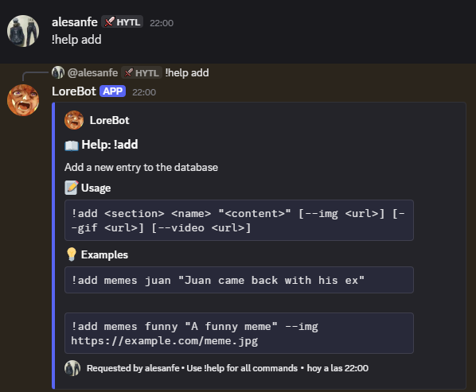

---

## Basic Commands

### Help

The help command displays comprehensive information about all available commands.

**Syntax:**
```
!help              # Display all commands organized by category
!help <command>    # Display detailed help for a specific command
```

**Example:**
```
!help add
```


---

### Ping

Check the bot's latency to Discord servers to diagnose connection issues.

**Syntax:**
```
!ping
```

**Example:**
```
!ping
```
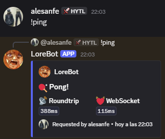

---

### Info

Display comprehensive server and bot information including member count, channels, and uptime.

**Syntax:**
```
!info
```

**Example:**
```
!info
```
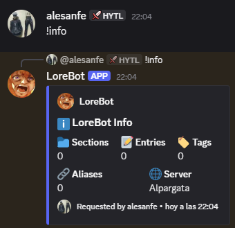

---

## Section Management

Sections act as categories or folders that group related entries together for better organization.

### Create a Section

Create a new section to organize your entries with a name and optional description.

**Syntax:**
```
!section create <name> "<description>"
```

**Example:**
```
!section create memes "Funny memes and inside jokes"
```

---

### List Sections

View all available sections in the server with their entry counts.

**Syntax:**
```
!section list
```

**Example:**
```
!section list
```
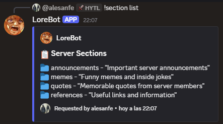

---

### View a Section

Display all entries within a specific section.

**Syntax:**
```
!section view <name>
```

**Example:**
```
!section view memes
```


---

### Delete a Section

Remove a section and all its entries permanently.

**Syntax:**
```
!section delete <name>
```

**Example:**
```
!section delete old_memes
```
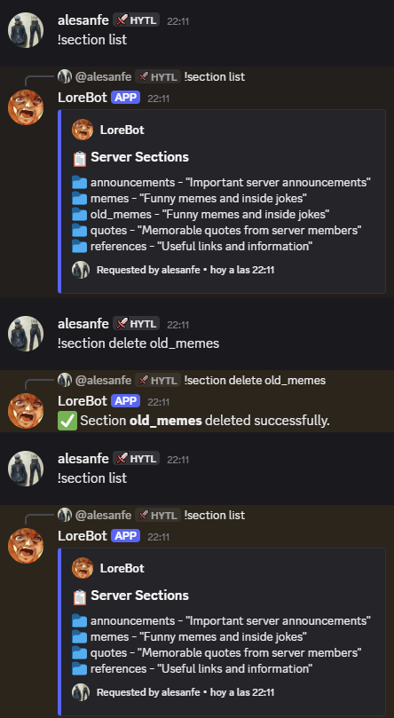

---

## Entry Management

Entries are the core content stored in LoreBot, supporting text, images, GIFs, and videos.

### Add an Entry

Save a new entry to the database with optional multimedia attachments.

**Syntax:**
```
!add <section> <name> "<content>" [--img <url>] [--gif <url>] [--video <url>]
```

**Example:**
```
!add memes juan "Juan came back with his ex"
```


---

### Show an Entry

Display an entry by name or alias with full content and attachments.

**Syntax:**
```
!show <name>
```

**Example:**
```
!show juan
```

---

### Edit an Entry

Modify an existing entry's content without recreating it.

**Syntax:**
```
!edit <name> "<new content>"
```

**Example:**
```
!edit juan "Juan came back with his ex AGAIN"
```

---

### Delete an Entry

Remove an entry from the database permanently with confirmation.

**Syntax:**
```
!delete <name>
```

**Example:**
```
!delete juan
```
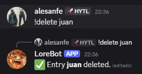

---

### Copy an Entry

Duplicate an entry to another section while keeping the original intact.

**Syntax:**
```
!copy <name> <section>
```

**Example:**
```
!copy juan archive
```
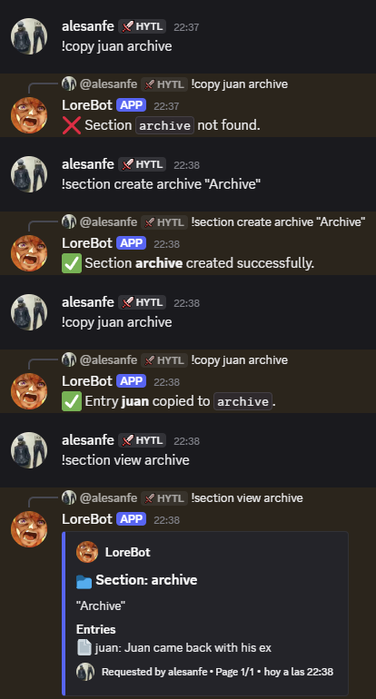

---

### Move an Entry

Move an entry from one section to another, removing it from the original.

**Syntax:**
```
!move <name> <section>
```

**Example:**
```
!move juan archive
```
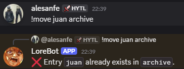

---

### Save a Message

Save an existing Discord message as an entry using its message ID.

**Syntax:**
```
!save <message_id>
```

**Example:**
```
!save 123456789012345678
```
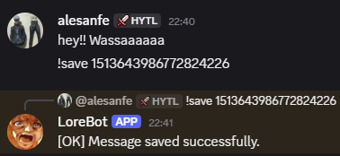

---

### Use an Entry

Display an entry and increment its use count to track popularity.

**Syntax:**
```
!use <name>
```

**Example:**
```
!use juan
```
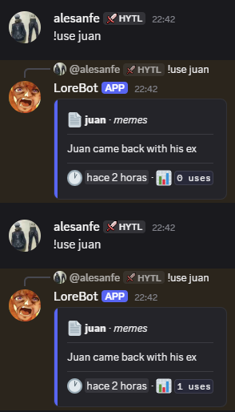

---

## Search & Discovery

Find entries by searching across names, content, and tags.

### Search

Search for entries across all fields including names, content, and tags.

**Syntax:**
```
!search <term>
```

**Example:**
```
!search juan
```
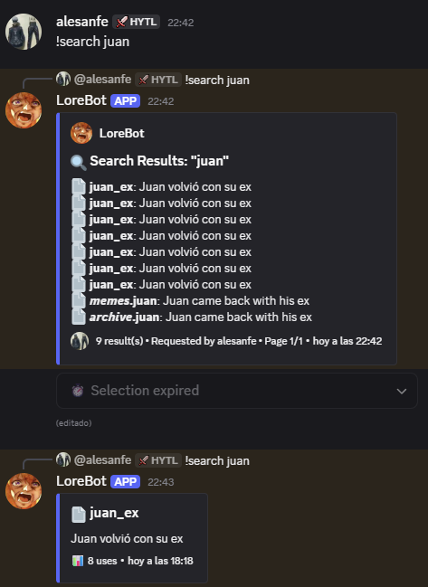

---

### Random Entry

Get a random entry from the database for discovery or entertainment.

**Syntax:**
```
!random [section]
```

**Example:**
```
!random
```
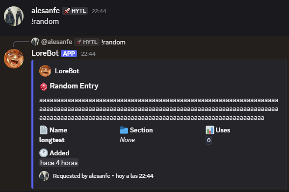

---

### Recent Entries

Show the most recently added entries to see what's new.

**Syntax:**
```
!recent [limit]
```

**Example:**
```
!recent
```
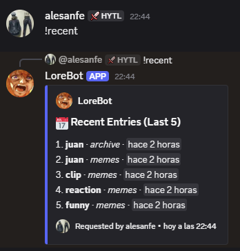

---

### Popular Entries

Show the most frequently used entries to identify community favorites.

**Syntax:**
```
!popular [limit]
```

**Example:**
```
!popular
```
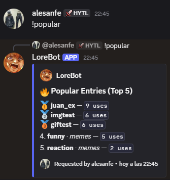

---

### Trending Entries

Show entries used most frequently in the last 7 days.

**Syntax:**
```
!trending [limit]
```

**Example:**
```
!trending
```
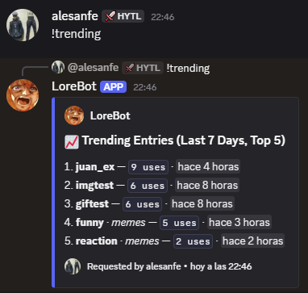

---

## Organization

Structure and categorize your content for better management and discovery.

### Tags

Add flexible labels to entries for easy searching and categorization.

**Syntax:**
```
!tag <entry> <tag>
```

**Example:**
```
!tag juan cringe
```
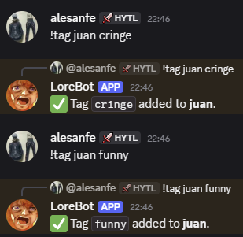

---

### Favorite

Mark or unmark an entry as a favorite for quick access.

**Syntax:**
```
!favorite <name>
```

**Example:**
```
!favorite juan
```
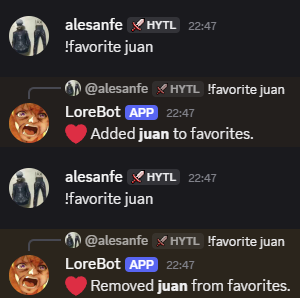

---

### Archive

Archive or unarchive an entry to hide it from normal views while preserving it.

**Syntax:**
```
!archive <name>
```

**Example:**
```
!archive juan
```
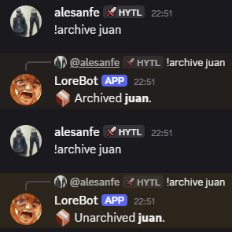

---

## Auto-Reactions

Automatically add emoji reactions to messages based on keywords.

### Add Auto-Reaction

Set up automatic reactions for specific keywords.

**Syntax:**
```
!autoreact add <emoji> <keyword>
```

**Example:**
```
!autoreact add 💀 cringe
```
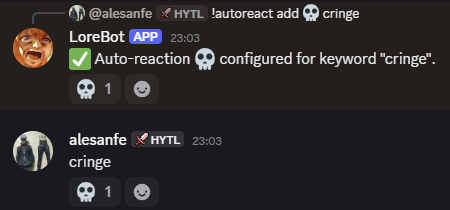

---

### List Auto-Reactions

View all configured auto-reactions for the server.

**Syntax:**
```
!autoreact list
```

**Example:**
```
!autoreact list
```
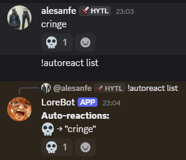

---

### Remove Auto-Reaction

Delete an auto-reaction configuration.

**Syntax:**
```
!autoreact remove <emoji> <keyword>
```

**Example:**
```
!autoreact remove 💀 cringe
```
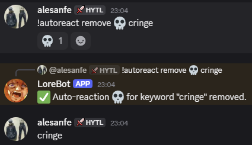

---

## Templates

Reusable content patterns with variable placeholders and multimedia support.

### Create a Template

Create a new template with variable placeholders and optional multimedia.

**Syntax:**
```
!template create <name> "<content with {variable}>" [--img <url>] [--gif <url>]
```

**Example:**
```
!template create gei "{username} es gei!!!" --gif https://usagif.com/wp-content/uploads/upgifsok/ha-gay-8.gif
```
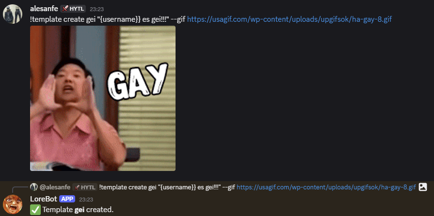

---

### List Templates

View all available templates in the server.

**Syntax:**
```
!template list
```

**Example:**
```
!template list
```


---

### Use a Template

Use a template with specific variable values to create content.

**Syntax:**
```
!template use <name> [variable=value ...]
```

**Example:**
```
!template use gei username=carmen
```
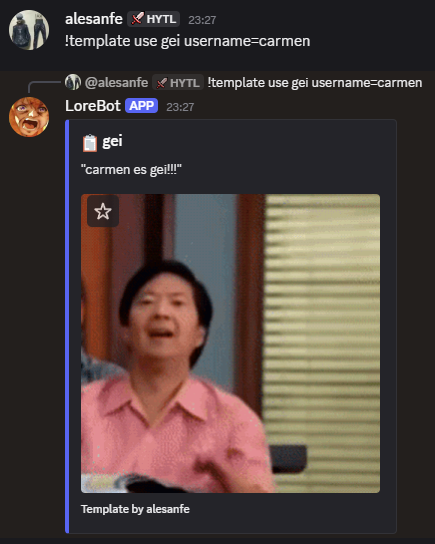

---

### Delete a Template

Remove a template from the database permanently.

**Syntax:**
```
!template delete <name>
```

**Example:**
```
!template delete gei
```
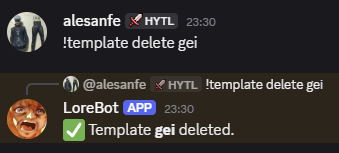

---

## Aliases

Alternate names for entries to make them easier to remember and use.

### Create an Alias

Create an alias for an existing entry.

**Syntax:**
```
!alias <name> <alias>
```

**Example:**
```
!alias juan exjuan
```

---

## Statistics & Info

View insights into your database and server activity.

### Statistics

View comprehensive bot and database statistics.

**Syntax:**
```
!stats
```

**Example:**
```
!stats
```

---

### Info

Display server and bot information.

**Syntax:**
```
!info
```

**Example:**
```
!info
```


---

## Utilities

Maintenance, backup, and security functions.

### Backup

Create a complete database backup file.

**Syntax:**
```
!backup
```

**Example:**
```
!backup
```

---

### Export

Export the database to a human-readable JSON file.

**Syntax:**
```
!export
```

**Example:**
```
!export
```

---

### Import

Import database data from a JSON file.

**Syntax:**
```
!import <file>
```

**Example:**
```
!import export_20240115_120000.json
```

---

### Clear

Delete bot messages in the channel.

**Syntax:**
```
!clear <count>
```

**Example:**
```
!clear 10
```

---

### Virus Check

Check if a URL is safe using VirusTotal.

**Syntax:**
```
!viruscheck <url>
```

**Example:**
```
!viruscheck https://google.com
```

---

## Administration

Control bot behavior and access for moderators and administrators.

### Permissions

Manage which users and roles can use specific commands.

#### Allow Command

Grant permission for a user or role to use a command.

**Syntax:**
```
!permissions allow <user/role> <command>
```

**Example:**
```
!permissions allow @Moderator !delete
```

---

#### Deny Command

Revoke permission for a user or role to use a command.

**Syntax:**
```
!permissions deny <user/role> <command>
```

**Example:**
```
!permissions deny @NewMember !delete
```

---

#### List Permissions

View all current permission settings.

**Syntax:**
```
!permissions list
```

**Example:**
```
!permissions list
```

---

### Cooldowns

Manage command cooldowns to prevent spam and abuse.

#### Set Cooldown

Set a cooldown period for a command.

**Syntax:**
```
!cooldown set <command> <seconds>
```

**Example:**
```
!cooldown set !add 60
```

---

#### List Cooldowns

View all current cooldown settings.

**Syntax:**
```
!cooldown list
```

**Example:**
```
!cooldown list
```

---

#### Remove Cooldown

Remove a cooldown from a command.

**Syntax:**
```
!cooldown remove <command>
```

**Example:**
```
!cooldown remove !add
```

---

**Version:** 1.0.0  
**Last Updated:** 2024-01-15
